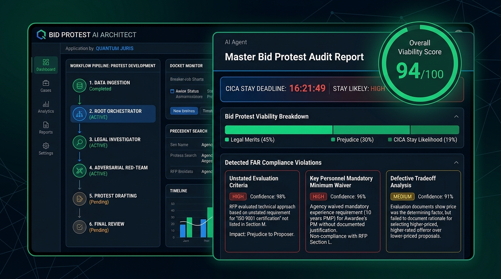

# Bid Protest AI Architect Skill

[](https://www.python.org/downloads/)
[](https://opensource.org/licenses/Apache-2.0)
[]()
[]()

A comprehensive, production-grade **AI Agent Skill** designed for **Gemini Enterprise App**, **Antigravity**, **Google ADK (Agent Development Kit)**, and any agent harness supporting `SKILL.md` and Skill Plug-ins.

This skill automates the forensic legal and technical audit of U.S. Federal Government procurement records (RFPs, proposals, Source Selection Decision Documents, Technical Evaluation Team consensus reports, and post-award debriefings) to identify, validate, and draft defensible **bid protest grounds** before the **Government Accountability Office (GAO)** and the **U.S. Court of Federal Claims (COFC)** under the Federal Acquisition Regulation (FAR) and 4 C.F.R. Part 21.

> [!IMPORTANT]
> **LEGAL DISCLAIMER & PRACTITIONER NOTICE**  
> This AI Agent Skill, its code, and documentation are provided for **informational, analytical, and workflow assistance purposes only**. This tool assists users by suggesting analytical steps to examine procurement packages and structuring factual findings. **This skill DOES NOT provide formal legal advice, legal representation, or a formal legal opinion.** Use of this tool does not create an attorney-client relationship. Users should always consult with a qualified government contracts attorney before filing any protest before the GAO, the U.S. Court of Federal Claims, or an executive agency.

---



---

## Table of Contents
1. [Executive Summary & Concept](#1-executive-summary--concept)
2. [Multi-Agent System Architecture & Pipeline](#2-multi-agent-system-architecture--pipeline)
3. [Search & Legal Retrieval Optimization](#3-search--legal-retrieval-optimization)
4. [Non-Technical User Quickstart Guide](#4-non-technical-user-quickstart-guide)
5. [Required Procurement Documents](#5-required-procurement-documents)
6. [Python CLI Tools & Execution](#6-python-cli-tools--execution)
7. [Synthetic Benchmark Dataset (Zero PHI/PII)](#7-synthetic-benchmark-dataset-zero-phipii)
8. [Testing & Verification](#8-testing--verification)
9. [Repository Structure](#9-repository-structure)
10. [Legal Framework & Precedents](#10-legal-framework--precedents)
11. [Legal Disclaimer & Terms of Use](#11-legal-disclaimer--terms-of-use)
12. [License](#license)

---

## 1. Executive Summary & Concept

A **bid protest** is a formal challenge to the award or terms of a federal contract filed by an interested party when the government violates procurement laws or conducts an unreasonable, non-compliant, or biased evaluation.

### Core Capabilities of the Skill
- **Automate Procurement Auditing**: Cross-examine procurement records across the 8 standard GAO protest categories.
- **Calculate Critical Deadlines**: Enforce the strict **5-day CICA Automatic Stay Rule** (31 U.S.C. § 3553(d)(4)) and **10-day GAO Filing Deadline** (4 C.F.R. § 21.2(a)(2)).
- **Establish Competitive Prejudice**: Apply the *Bannum* test to verify that agency errors directly altered the award outcome.
- **Simulate Adversarial Agency Defense**: Red-team every potential count from the perspective of Government Agency Counsel to eliminate subjective or weak claims.
- **Synthesize Filings**: Produce both a Markdown Master Bid Protest Audit Report and a formal GAO Protest Pleading.

---

## 2. Multi-Agent System Architecture & Pipeline

The skill executes a parallelized, category-driven multi-agent pipeline designed for rigorous factual cross-examination:

```
                      ┌──────────────────────────────┐
                      │        Legal Expert          │
                      │  (User / Principal Attorney) │
                      └──────────────┬───────────────┘
                                     │
                                     ▼
                      ┌──────────────────────────────┐
                      │       Root Orchestrator      │
                      │   - Timeliness & Standing    │
                      │   - Category Pipeline        │
                      └──────────────┬───────────────┘
                                     │
             ┌───────────────────────┴───────────────────────┐
             ▼                                               ▼
┌─────────────────────────────┐                 ┌─────────────────────────────┐
│     Category Processor      │                 │     RFP Matrix Extractor    │
│  - Section L vs Section M   │                 │  - Factor Weights & Ratings │
└──────────────┬──────────────┘                 └──────────────┬──────────────┘
             │                                               │
             └───────────────────────┬───────────────────────┘
                                     │
                                     ▼
                      ┌──────────────────────────────┐
                      │     Protest Strategist       │
                      │  - Generates 8-Ground Audits │
                      │  - Multi-Query Formulations  │
                      └──────────────┬───────────────┘
                                     │
                                     ▼
                      ┌──────────────────────────────┐
                      │    Document Investigator     │
                      │  - Hybrid Search / Vertex    │
                      │  - Cross-Doc Evidence Mining │
                      └──────────────┬───────────────┘
                                     │
                                     ▼
                      ┌──────────────────────────────┐
                      │   Adversarial Critique Agent │
                      │  - Red Team / Agency Counsel │
                      │  - Pass / Fail Gate          │
                      └──────────────┬───────────────┘
                                     │ Pass
                                     ▼
                      ┌──────────────────────────────┐
                      │   Report & Pleading Builder  │
                      │  - Markdown Master Report    │
                      │  - Formal GAO Filing Draft   │
                      └──────────────────────────────┘
```

### Core Architecture Components:
1. **Deterministic RFP Baseline Extraction**: Parses Section L mandatory clauses and Section M relative factor weights into a structured evaluation matrix prior to reasoning.
2. **Adversarial Red-Team Gate**: Stress-tests each potential ground against agency discretion standards and competitive prejudice requirements.
3. **Automated Statutory Deadline Calculator**: Computes CICA stay and GAO statutory deadlines directly from debriefing timestamps.

---

## 3. Search & Legal Retrieval Optimization

Legal and federal procurement records require high-precision retrieval to capture binding contract terms (`shall`, `must`, `mandatory minimum`), tabular rating matrices, and specific numeric thresholds.

### The 3-Tier Legal Query Optimization Pipeline
The skill uses structured query expansion to ensure thorough discovery across the document corpus:

```
[User / Agent Goal]
        │
        ▼
[Legal Query Expander] ──► Generates 4 Query Variants:
        │                   ├─ 1. Exact Legal Ground Pattern (e.g., "Section L.4 mandatory experience")
        │                   ├─ 2. FAR Statutory Rule (e.g., "FAR 15.305 unstated evaluation criteria")
        │                   ├─ 3. Offeror Comparative Pair (e.g., "Apex 14 years vs Nexus 4 years")
        │                   └─ 4. Adjectival Rating Cross-Reference (e.g., "TET Consensus Key Personnel")
        │
        ▼
[Direct Vertex AI Search / Hybrid Engine]
        │ ├─ Direct REST/gRPC API invocation
        │ ├─ Hybrid Search (Dense Embeddings + Sparse BM25)
        │ ├─ Snippet Spec: max_snippet_count=5, extractive_answers_spec
        │ └─ Relevance Reranking
        │
        ▼
[Structured Matrix Alignment] ──► Maps findings into unified JSON evaluation matrix
```

To run the search retrieval diagnostics and benchmark:
```bash
python3 scripts/search_diagnostics.py --data synthetic_data
```

---

## 4. Non-Technical User Quickstart Guide

If you are using **Gemini Enterprise App**, **Antigravity**, **ChatGPT**, or **Claude**, follow these simple steps:

### Step 1: Upload or Point to Your Procurement Files
Ensure your procurement files (or the provided `synthetic_data/` folder) are accessible in your workspace:
- Solicitation / RFP (Sections L & M)
- Protester Proposal Excerpt
- Awardee Proposal Excerpt (if available from debriefing)
- Technical Evaluation Report / Consensus Scorecards
- Source Selection Decision Document (SSDD)
- Post-Award Debriefing Letter

### Step 2: Paste the Execution Prompt
Copy and paste this prompt into your agent chat interface:

```text
Please execute the Bid Protest Architect Skill on our procurement package located in the synthetic_data/ directory.

Analyze the solicitation (solicitation_rfp_section_lm.md), our proposal (proposal_apex_protester.md), the awardee's proposal (proposal_nexus_awardee.md), the technical evaluation report (technical_evaluation_report.md), the SSDD (ssdd_source_selection_decision.md), and our debriefing letter (debriefing_letter.md).

Please:
1. Verify timeliness and CICA stay deadlines based on our debriefing date.
2. Extract Section L and Section M requirements into an evaluation baseline.
3. Investigate all 8 standard bid protest grounds (especially unstated criteria, disparate treatment, mandatory minimums, past performance, and tradeoff rationales).
4. Apply an adversarial critique red-team to eliminate weak arguments.
5. Generate the complete Master Bid Protest Audit Report with FAR citations and GAO precedents.
```

### Step 3: Review the Generated Report
The agent will produce:
- **Master Bid Protest Audit Report** (Markdown) with viability scores and statutory deadlines.
- **Formal GAO Protest Pleading** ready for outside legal counsel review.

---

## 5. Required Procurement Documents

For maximum audit thoroughness, provide the following documents:

| Document | Purpose in Audit | Key Sections Inspected |
|---|---|---|
| **Solicitation (RFP)** | Establishes the legal evaluation baseline | **Section L** (Instructions) & **Section M** (Evaluation Factors) |
| **Protester Proposal** | Demonstrates compliance and technical superiority | Executive Summary, Technical Volume, Key Personnel Resumes, Past Performance |
| **Awardee Proposal** | Identifies non-compliance and waived minimums | Key Personnel Qualifications, Technical SLAs, Subcontracting Plan |
| **Technical Evaluation Report** | Exposes unstated criteria and scoring disparities | SSEB/TET Consensus Strengths, Weaknesses, Deficiencies, Rating Justifications |
| **Source Selection Decision (SSDD)** | Exposes defective cost-technical tradeoffs | SSA Tradeoff Narrative, Price Premium Rationale, Rating Tables |
| **Debriefing Letter & Q&A** | Determines statutory timeliness and CICA stay | Award Notice Date, Written Debriefing Date, Agency Q&A Conclusion Date |

---

## 6. Python CLI Tools & Execution

The repository provides standalone, production-ready Python tools that run locally or in automated CI/CD pipelines with zero required external dependencies (uses standard library by default):

### 1. Automated Bid Protest Analyzer
Runs end-to-end evaluation, discrepancy detection, prejudice analysis, and report generation:
```bash
python3 scripts/bid_protest_analyzer.py --data synthetic_data --output output/master_bid_protest_report.md --json-output output/audit_results.json
```

### 2. Search Retrieval Diagnostics & Accuracy Benchmark
Evaluates retrieval performance across natural language, direct keyword, and optimized legal queries:
```bash
python3 scripts/search_diagnostics.py --data synthetic_data
```

### 3. Formal GAO Pleading Generator
Generates a formal legal pleading formatted for GAO docketing:
```bash
python3 scripts/generate_protest_filing.py --data synthetic_data --output output/gao_formal_protest_filing.md --counsel "Jane Doe, Esq." --firm "Sterling, Vance & Associates, LLP"
```

### 4. Corpus Indexer & Matrix Extractor
Parses procurement packages into structured JSON evaluation matrices:
```bash
python3 scripts/corpus_indexer.py synthetic_data
```

---

## 7. Synthetic Benchmark Dataset (Zero PHI/PII)

The `synthetic_data/` directory contains a realistic, synthetic civilian healthcare cloud procurement package (*HHS/CMS Federal Healthcare Infrastructure Security & Cloud Modernization - RFP No. HHS-CMS-2026-CLOUD-009*).

### Embedded Protest Grounds for Testing:
1. **Unstated Evaluation Criteria (FAR 15.305)**: TET assigned a Significant Weakness to Apex for lacking an "on-premises physical datacenter hardware bridge" (never required in Section L or M).
2. **Waiver of Mandatory Key Personnel Qualifications (FAR 15.206)**: Agency accepted Nexus's Lead Architect who possessed only 4 years experience (Section L mandated 10 years and AWS Pro/CISSP certifications).
3. **Unenforced Mandatory SLA Minimum (FAR 15.206)**: Agency awarded contract despite Nexus proposing a 99.95% SLA (Section L.3.1 established mandatory 99.99% minimum threshold).
4. **Flawed Past Performance Evaluation (FAR 15.305(a)(2))**: Agency awarded Satisfactory Confidence to Nexus based on a $3.2M commercial retail website (Section L.5 required $50M+ enterprise federal cloud).
5. **Defective Best Value Tradeoff (FAR 15.308)**: SSA mechanically selected Nexus based on price without articulating a qualitative tradeoff, despite Section M stating Non-Price factors were *significantly more important than Price*.

---

## 8. Testing & Verification

The test suite validates timeliness calculations, ground detection, prejudice analysis, markdown parsing, and search retrieval accuracy:

```bash
# Run all unit and integration tests
python3 -m unittest discover -s tests -p "test_*.py"
```

### Test Coverage Summary:
- `TestTimelinessCalculator`: Verifies 5-day CICA stay, 10-day GAO limit, and weekend rollover logic.
- `TestBidProtestAnalyzer`: Verifies detection of all 5 embedded counts, competitive prejudice verification, and report synthesis.
- `TestSearchDiagnostics`: Verifies markdown stripping, token scoring, and precision on optimized legal RAG queries.

---

## 9. Repository Structure

```
bid-protest-architect-skill/
├── .gitignore                        # Git configuration and ignore patterns
├── LICENSE                           # Apache License, Version 2.0
├── SKILL.md                          # Universal Skill definition for Agent Harnesses
├── README.md                         # Master documentation and quickstart guide
├── requirements.txt                  # Python dependencies
├── pyproject.toml                    # Package build & metadata configuration
├── docs/
│   └── images/
│       └── skill_in_action.jpg       # Dashboard preview image
├── scripts/
│   ├── bid_protest_analyzer.py       # Core automated multi-stage analyzer CLI
│   ├── search_diagnostics.py         # Diagnostic benchmark (Vertex AI Search vs Local Hybrid)
│   ├── corpus_indexer.py             # Parses procurement packages into structured JSON
│   ├── generate_protest_filing.py    # Generates formal GAO legal pleading
│   ├── build_synthetic_data.py       # Builder utility for synthetic procurement files
│   └── build_docs.py                 # Builder utility for references & templates
├── tests/
│   ├── test_analyzer.py              # Automated unit tests for audit logic and deadlines
│   └── test_search_diagnostics.py    # Unit tests for search diagnostics and accuracy
├── synthetic_data/                   # Fully synthetic, non-PHI/PII procurement package
│   ├── README.md                     # Data overview and ground injection guide
│   ├── solicitation_rfp_section_lm.md# Section L (Instructions) & Section M (Evaluation Factors)
│   ├── debriefing_letter.md          # Post-award written debriefing & Q&A timeline
│   ├── ssdd_source_selection_decision.md # Source Selection Decision Document
│   ├── technical_evaluation_report.md# TET consensus evaluation report
│   ├── proposal_apex_protester.md    # Apex Federal Solutions proposal excerpt
│   └── proposal_nexus_awardee.md     # Nexus Defense Systems proposal excerpt
├── references/
│   ├── gao_precedents_handbook.md    # Landmark GAO/COFC case law principles and citations
│   ├── protest_grounds_taxonomy.md   # Taxonomy of the 8 core bid protest grounds
│   ├── search_optimization_guide.md  # Guide to legal term-of-art query expansion and hybrid RAG
│   └── agent_orchestration_patterns.md # Multi-agent orchestration specifications
├── resources/
│   ├── templates/
│   │   ├── bid_protest_report_template.md # Master Markdown report template
│   │   └── gao_formal_protest_template.md # Formal GAO legal filing template
│   └── checklists/
│       └── protest_viability_checklist.md # Timeliness, standing, and prejudice checklist
├── examples/
│   ├── sample_run_output.md          # Complete sample report generated from synthetic dataset
│   └── sample_prompts.md             # Plug-and-play prompts for Gemini Enterprise, Claude, ChatGPT
├── output/                           # Sample generated reports & JSON audit models
│   ├── master_bid_protest_report.md  # Generated Master Audit Report
│   ├── gao_formal_protest_filing.md  # Generated formal GAO pleading draft
│   └── audit_results.json            # Machine-readable structured audit model
└── scratch/                          # Working directory for parsed indexes and temporary caches
    └── procurement_index.json        # Structured JSON evaluation matrix cache
```

---

## 10. Legal Framework & Precedents

The skill implements strict compliance with federal procurement law:

- **FAR Part 15**: Contracting by Negotiation (Source Selection Processes and Techniques)
- **FAR 15.305**: Proposal Evaluation
- **FAR 15.308**: Source Selection Decision
- **FAR 15.206**: Amending the Solicitation / Mandatory Minimums
- **FAR 15.506**: Postaward Debriefing of Offerors
- **FAR Subpart 9.5**: Organizational and Consultant Conflicts of Interest
- **4 C.F.R. Part 21**: GAO Bid Protest Regulations
- **31 U.S.C. § 3553(d)(4)**: CICA Automatic Stay of Contract Performance
- **Landmark GAO Decisions**:
  - *Alion Science & Technology Corp.*, B-400760 (Unstated Evaluation Criteria)
  - *Raytheon Co.*, B-409651 (Disparate Treatment)
  - *ArmorWorks Enterprises, LLC*, B-400394 (Mandatory Minimum Requirements)
  - *Blue Rock Structures, Inc.*, B-293134 (Defective Best Value Tradeoff)
  - *Fluor Federal Solutions, LLC*, B-414223 (Past Performance Relevance)
  - *Bannum, Inc. v. United States*, 404 F.3d 1346 (Competitive Prejudice Standard)

---

## 11. Legal Disclaimer & Terms of Use

1. **Not Legal Advice**: The contents of this skill, its underlying code, templates, and analytical outputs are provided strictly for **informational, educational, and workflow automation purposes**. They do not constitute formal legal advice, legal opinions, or professional legal representation.
2. **No Attorney-Client Relationship**: Execution or use of this skill, or interaction with any agent using this skill, does not establish an attorney-client relationship between the user and the authors, contributors, or tool developers.
3. **Requirement for Qualified Legal Counsel**: Federal government procurement law is highly dynamic, subject to agency-specific supplements (e.g., DFARS, HHSAR), and governed by strict procedural rules and protective orders. Users must consult licensed, qualified government contracts legal counsel to review procurement records, assess protest viability, and prepare official filings before the GAO, Court of Federal Claims, or executive agencies.
4. **Independent Verification**: Users and practitioners are solely responsible for independently verifying all statutory citations, FAR references, mathematical calculations, and factual assertions generated by this tool prior to taking formal legal action.

---

## License

This project and skill repository is licensed under the **Apache License, Version 2.0** (the "License"). You may use, distribute, and modify this code in compliance with the License.

See the complete license terms in the [LICENSE](LICENSE) file or visit [http://www.apache.org/licenses/LICENSE-2.0](http://www.apache.org/licenses/LICENSE-2.0).
